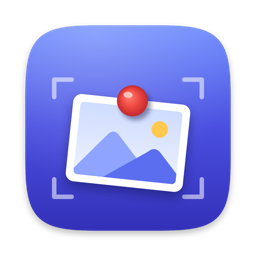

<p align="center"></p>

# Pinna

A macOS menu bar app for pinning screenshots. Take one and it floats on top of everything, right where you took it, and it's already on your clipboard. Mark it up, select its text, fade it out, or make it click-through so you can work underneath it.

Pinna is in English and Simplified Chinese, and needs macOS 14 or later.

## Install

```sh
./build.sh                         # → build/Pinna.app
cp -R build/Pinna.app /Applications/
```

Building needs Xcode or the Swift toolchain. The first capture asks for **Screen Recording** permission: turn Pinna on in System Settings › Privacy & Security › Screen & System Audio Recording, then reopen Pinna.

## Taking a screenshot

Press **⇧⌘2**, or click the pin in the menu bar and choose **Capture & Pin**. The screen freezes, so open menus and hover effects stay put while you choose what to capture.

| | |
|---|---|
| Drag | Select an area. Its size is shown as you drag. |
| Space, then click | Pick a window instead. The window is captured on its own, without its shadow or whatever covers it. Space again goes back to selecting an area. |
| Hold Space while dragging | Move the selection instead of resizing it. |
| C | Copy the color under the pointer as hex (like `#1E90FF`). |
| Esc | Cancel. |

A magnifier next to the pointer shows the pixels around it, the color of the one in the middle, and where it is on the screen.

The screenshot is copied to the clipboard and pinned exactly where it was on screen. **Capture Same Area Again** takes a new screenshot of the same area straight away, without your pins in it. It's handy for watching something change.

### Other ways to pin an image

- **Pin Image from Clipboard**, in the menu bar menu, pins a copied image or image file.
- **Open Image…** pins image files. You can also drop them on the menu bar icon, or open them with Pinna from Finder (Open With).

## Working with a pin

| | |
|---|---|
| Move | Drag the screenshot or its title bar, or press the arrow keys (⇧ for 10 points at a time). |
| Resize | Drag an edge or corner. See [Resizing](#resizing). |
| Zoom | Scroll or pinch, or ⌘= ⌘- ⌘0 (actual size). The zoom level is shown as you go. |
| Fit to screen | Green button. |
| Opacity | ⌥-scroll, or right-click › Opacity. |
| Copy | ⌘C. If text is selected, this copies the text. |
| Copy all its text | ⇧⌘C. |
| Select text | ⌘T, or the text button in the title bar. See [Live Text](#live-text). |
| Mark up | ⇧⌘A, or the pencil button in the title bar. See [Markup](#markup). |
| Save as PNG | ⌘S. |
| Drag into another app | ⌥-drag the screenshot into Finder, Mail, Slack, a document… |
| Keep on top | Pin button in the title bar, or right-click › Keep on Top. |
| Show on every Space | Right-click › Show on All Spaces. See [Full-screen apps and Spaces](#full-screen-apps-and-spaces). |
| Click through | Right-click › Click Through. Clicks then go to whatever is behind the pin. Turn it off by choosing the pin in the menu bar menu. |
| Minimize | Yellow button. |
| Close | Red button, Esc, ⌘W, or double-click. Closed pins can be reopened. |
| Everything else | Right-click. |

### Resizing

By default a pin keeps the screenshot's proportions as you resize it. Choose **Stretch freely** in Settings to resize to any shape. Holding **⇧** while you drag does the opposite of the setting, and right-click › **Keep Proportions** switches one pin. Turning Keep Proportions back on returns a stretched screenshot to its own shape.

### Markup

Click the pencil in the title bar, or press ⇧⌘A, and a toolbar appears below the pin.

| Tool | Key | |
|---|---|---|
| Arrow | A | ⇧ keeps it at 45° steps. |
| Rectangle | R | ⇧ makes a square. |
| Ellipse | O | ⇧ makes a circle. |
| Pen | P | Draw freehand. |
| Highlighter | H | ⇧ keeps it straight. |
| Text | T | Click, type, then press Return. |
| Pixelate | B | Hide something by blurring it into blocks. |
| Crop | C | Drag out the part to keep. |

Choose a color and a line thickness from the toolbar. ⌘Z undoes, ⇧⌘Z redoes, and Delete removes the last mark. **Done** (Return) draws the marks into the screenshot and copies the result. **Cancel** (Esc) throws them away. A cropped pin stays where that part of it was on screen.

### Live Text

Click the text button in the title bar, or press ⌘T, then drag across text to select it, just like in Preview. Links, dates, phone numbers and other recognized details can be clicked. Away from text, dragging still moves the pin. To copy all the text in a screenshot without selecting it, press ⇧⌘C.

## The menu bar menu

Every open pin is listed with a thumbnail, its size and the time it was taken. Choosing one brings it to the current desktop, in front, with click-through turned off. Hold ⌥ to close a pin instead.

- **Bring All Pins Here** does the same for every pin.
- **Hide All Pins** / **Show All Pins** gets them out of the way, for example while you share your screen.
- **Reopen Closed Pin** brings back the last closed pin, up to 20 of them.
- **Close All Pins** closes them all.

## Full-screen apps and Spaces

A pin normally belongs to the desktop (Space) it was taken on. That keeps each desktop's pins separate, but macOS doesn't let you drag a window into a full-screen app. To have a pin there:

- Take the screenshot while you're in the full-screen app. The pin appears there.
- Choose the pin in the menu bar menu while you're in the full-screen app, or choose **Bring All Pins Here**. macOS can't move a window to another Space, so Pinna replaces the pin with an identical one on the current Space.
- Turn on **Show on All Spaces** for the pin (right-click), or for all new pins in Settings. The pin then follows you everywhere, full-screen apps included.

## Settings

Choose **Settings…** from the menu bar menu.

- **Shortcuts.** Any of these can work from any app: Capture & Pin, Capture Same Area Again, Pin Image from Clipboard, Hide or Show All Pins, and Reopen Closed Pin. Only Capture & Pin (⇧⌘2) has one to start with. Click a shortcut and press the keys you want. A shortcut needs ⌘, ⌥ or ⌃, unless it's an F-key. Click ⓧ to remove a shortcut.
- **New pins.** Choose whether resizing keeps proportions, whether pins stay on top, and whether they show on all Spaces.
- **Launch Pinna at login.** If macOS asks you to approve this, the **Allow in Login Items…** button opens the right place.
- **Reopen pins from last time.** If this is on, the pins open when Pinna quits come back next time. They're kept in `~/Library/Application Support/Pinna/Pins`.

## Development

```sh
swift build                        # debug build
swift test                         # unit tests
./build.sh                         # build/Pinna.app
```

`build.sh` takes these options as environment variables:

| | |
|---|---|
| `SIGN_IDENTITY="Developer ID Application: …"` | Sign with your certificate and the hardened runtime. Without it, the app is signed ad hoc, and macOS asks for Screen Recording permission again after every rebuild. |
| `UNIVERSAL=1` | Build for both Apple silicon and Intel. |
| `NOTARY_PROFILE=…` | Notarize with Apple and staple the ticket, using a profile saved with `xcrun notarytool store-credentials`. Needs a Developer ID `SIGN_IDENTITY`. |
| `DMG=1` | Also make `build/Pinna.dmg`. It's signed and notarized too if those options are set. |

For example, to make a release anyone can open:

```sh
SIGN_IDENTITY="Developer ID Application: Your Name (TEAMID)" NOTARY_PROFILE=pinna UNIVERSAL=1 DMG=1 ./build.sh
```

### Layout

| | |
|---|---|
| `Sources/Pinna/AppDelegate.swift` | The menu bar item and its menu, global shortcuts, capturing, and opening images. |
| `Capturer.swift`, `CaptureSession.swift` | Freezing the screens with ScreenCaptureKit, and the full-screen selection with its magnifier. |
| `PinWindow.swift`, `PinView.swift`, `PinGeometry.swift` | A pin and its sizing rules. |
| `PinManager.swift`, `PinStore.swift` | Keeping track of pins, and saving them between launches. |
| `Markup.swift`, `MarkupEditor.swift` | Annotations: drawing them, and the editor and toolbar. |
| `Screenshot.swift` | An image with its scale, as PNG and on the clipboard. |
| `SettingsWindow.swift`, `Preferences.swift`, `Shortcut.swift`, `HotKey.swift` | Settings and shortcuts. |
| `Resources/` | `Info.plist`, the icon, and translations. |
| `scripts/make-icon.swift` | Draws the icon: `swift scripts/make-icon.swift Resources/AppIcon.icns`. |
| `scripts/check-localizations.sh` | Lists strings that aren't translated, or are translated but no longer used. |

### Translations

Text in the code is English, written as `String(localized: "…")`. Translations are in `Resources/<language>.lproj/Localizable.strings`, keyed by the English text. After changing any text, run `scripts/check-localizations.sh`. To add a language, copy `zh-Hans.lproj`, translate it, and add the language to `CFBundleLocalizations` in `Info.plist`.
